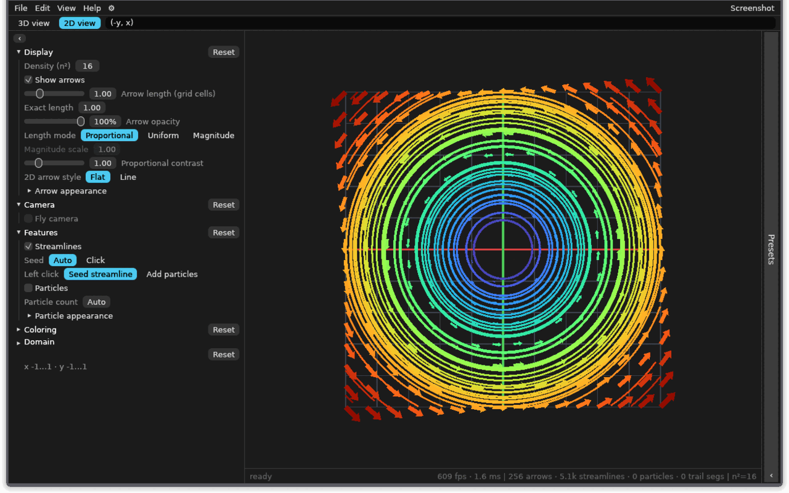

<p align="center">
  
</p>

# Vector Field Explorer

Type a vector field as a formula and explore it as arrows, streamlines, and
particles in 2D or 3D. Runs natively on Linux and macOS, and in the browser as
a WebAssembly build.



Download the latest release from
[github.com/ttgg1/vector-field-explorer/releases/latest](https://github.com/ttgg1/vector-field-explorer/releases/latest).

## What it is

Vector Field Explorer is a formula-driven viewer for fields
`f(x, y) -> (u, v)` and `f(x, y, z) -> (u, v, w)`. Type an expression, or load
one of the built-in field presets, and the viewport draws the field as an
instanced GPU scene:

- arrows coloured by magnitude, with separate 2D and 3D arrow families;
- streamlines traced with RK4, seeded from the grid or from clicks;
- animated particles with trails and speed or magnitude colouring;
- a 2D orthographic view and a 3D orbit camera, plus a free-fly camera;
- adjustable domain, density, arrow lengths, opacity, colormaps, and
  plane-by-plane inspection;
- native PNG screenshots and persisted view, layout, and appearance settings.

It is a teaching-grade explorer, not a numerical solver: there is no
differentiation, divergence, curl, or field-equation solver in this release.
The architecture and module map are in [docs/CODEBASE.md](docs/CODEBASE.md);
domain vocabulary and settled decisions are in [GLOSSARY.md](GLOSSARY.md) and
[docs/adr/](docs/adr/).

## Install

### Linux

Download `vector-field-explorer-<version>-x86_64-unknown-linux-gnu.AppImage`
from the [latest release](https://github.com/ttgg1/vector-field-explorer/releases/latest),
make it executable, and run it:

```sh
chmod +x vector-field-explorer-*-x86_64-unknown-linux-gnu.AppImage
./vector-field-explorer-*-x86_64-unknown-linux-gnu.AppImage
```

The AppImage is one self-contained file. It uses the host GPU driver and
requires a Vulkan-capable driver (or a software implementation such as
`mesa-vulkan-drivers`); it does not bundle Mesa. If FUSE 2 is unavailable, run
it with `--appimage-extract-and-run` or install `libfuse2`. The AppImage's
`README.md`, `LICENSE`, and `THIRD_PARTY_LICENSES.md` are installed under
`usr/share/doc/vector-field-explorer/`.

### macOS

Download the archive for your Mac: `aarch64-apple-darwin` for Apple Silicon or
`x86_64-apple-darwin` for Intel. Unzip it and open
`vector-field-explorer.app`. The archive also contains `README.md`, `LICENSE`,
and `THIRD_PARTY_LICENSES.md`.

The macOS builds are unsigned and not notarized. On macOS 15 (Sequoia) and
later, the first launch is blocked; approve it in **System Settings → Privacy &
Security**, then choose **Open Anyway**. On older macOS, right-click (or
Control-click) the app and choose **Open**.

## Browser build and WebGPU

The browser build is the same Rust application compiled to
`wasm32-unknown-unknown`. It needs WebGPU; there is deliberately no WebGL2 or
CPU-rendering fallback. If the browser cannot provide a WebGPU adapter, the app
shows its own unsupported-browser panel with the failure reason instead of a
blank canvas. The panel's browser guidance is the same text as
`#webgpu-unsupported` in `index.html`.

A hosted browser build is planned for the project Pages site after the release;
it is not live yet. Build it locally with [Trunk](#browser-build-with-trunk).

### Browser support

WebGPU support is still uneven. This is the status as of November 2026:

| Browser | WebGPU status |
| --- | --- |
| Chrome / Edge | Available since version 113 on Windows, macOS, and ChromeOS. Linux support is rolling out: Intel Gen12+ from Chrome 144, NVIDIA on Wayland from Chrome 147 (driver 535.183.01+); other Linux configurations may need flags. |
| Firefox | Windows: 141+. macOS 26 Tahoe on Apple Silicon: 145+; all supported macOS versions: 147+. Linux: Nightly only, not Stable or Beta. |
| Safari | 26+ on macOS 26 Tahoe, iOS 26, and iPadOS 26. |

Sources: [MDN WebGPU API](https://developer.mozilla.org/en-US/docs/Web/API/WebGPU_API)
(limited availability), the [WebGPU implementation status](https://github.com/gpuweb/gpuweb/wiki/Implementation-Status),
[Mozilla's Firefox 141 announcement](https://mozillagfx.wordpress.com/2025/07/15/shipping-webgpu-on-windows-in-firefox-141/),
the [Firefox 145 release notes](https://www.firefox.com/en-US/firefox/145.0/releasenotes/),
the [Firefox 147 release notes](https://www.firefox.com/en-US/firefox/147.0/releasenotes/),
and [caniuse](https://caniuse.com/webgpu).

### Firefox on Linux

Linux Firefox Stable and Beta have WebGPU disabled today. Firefox Nightly has
it enabled by default, and Mozilla lists a Linux release as expected in 2026.
Use Nightly for a supported path.

To check or enable it:

1. Install Firefox Nightly from <https://www.firefox.com/en-US/channel/desktop/>.
2. Open `about:config` and accept the warning.
3. Check `dom.webgpu.enabled`. Nightly should already have it set to `true`; if
   the preference is present and `false`, set it to `true`.
4. If your GPU or driver is blocklisted, set
   `gfx.webgpu.ignore-blocklist` to `true`. Only do this when you know the
   driver works with Vulkan; a broken driver can crash the GPU process.
5. Restart Firefox.
6. Open the developer console and evaluate `navigator.gpu`. If it is
   `undefined`, WebGPU is still off. Then evaluate
   `await navigator.gpu.requestAdapter()`; `null` means no compatible adapter
   was found.

Firefox uses Vulkan for WebGPU on Linux. Install your distribution's Vulkan
driver package (for AMD and Intel Mesa, usually `mesa-vulkan-drivers`; NVIDIA
users need a recent proprietary driver with Vulkan support).
`vulkaninfo --summary` should list a device. The RADV (AMD) and ANV (Intel)
Mesa drivers are the usual choice; the software `lavapipe` driver also works
but is slow. Hardware acceleration must be enabled in Firefox's settings.

Troubleshooting:

- **`navigator.gpu` is `undefined`**: wrong Firefox channel, an older build, or
  the preference is off. Update Nightly or set `dom.webgpu.enabled`.
- **`requestAdapter()` returns `null`**: no Vulkan device, a blocklisted
  driver, a VM or remote session without GPU access, or hardware acceleration
  is off. Check `vulkaninfo --summary`, update Mesa, and try
  `gfx.webgpu.ignore-blocklist`.
- **The app shows its unsupported-browser panel**: read the reason line. The
  browser either lacks WebGPU or could not return an adapter; the app does not
  fall back to WebGL.
- **X11 vs Wayland**: try the other session type. Chromium's Linux WebGPU
  support differs between them (NVIDIA WebGPU on Wayland arrived in Chrome 147),
  and Firefox's GPU process can behave differently under each compositor.
- **Remote desktop, VM, or headless session**: WebGPU needs a usable local GPU
  and driver; software rendering may not expose one to the browser.

## Build from source

### Toolchain and system dependencies

Use a current stable Rust toolchain (edition 2024) installed through `rustup`.

Linux (Debian/Ubuntu package names; use the equivalents for your distribution):

```sh
sudo apt install build-essential pkg-config \
  libxkbcommon-dev libwayland-dev libx11-dev libxi-dev \
  libgl1-mesa-dev libvulkan-dev \
  mesa-vulkan-drivers libxkbcommon-x11-0
```

macOS: install the Xcode command-line tools (`xcode-select --install`).

### Native build

```sh
cargo build
cargo run --release
```

Run the test suite and the lint gate:

```sh
scripts/test.sh
cargo clippy --all-targets -- -D warnings
```

`scripts/test.sh` runs `cargo test --all-targets` and then removes stale test
binaries from `target/debug/deps`. Set `KEEP_TEST_ARTIFACTS=1` to keep them.

The runtime smoke test builds and launches the app for a few seconds, failing on
panics, wgpu validation errors, shader parse errors, and missing fonts:

```sh
scripts/smoke-run.sh 15
```

It needs a display. CI runs it headlessly with `xvfb-run`, software Vulkan
(`WGPU_BACKEND=vulkan`, `mesa-vulkan-drivers`), and `libxkbcommon-x11-0`.

### Browser build with Trunk

Install the WebAssembly target and Trunk 0.22.1 (the version pinned by the CI
wasm job in `.github/workflows/ci.yml` and matching the `wasm_bindgen` 0.2.130
pin in `Trunk.toml`), then serve or build:

```sh
rustup target add wasm32-unknown-unknown
cargo install trunk --version 0.22.1 --locked
trunk serve --release
```

Open <http://127.0.0.1:8080/>. A production bundle is written to `dist/` by:

```sh
trunk build --release
```

`scripts/test-web.sh` performs the same check and build in one step, then
verifies that `dist/` contains the HTML, wasm, JavaScript, manifest, Open Graph
image, and icon files. It selects the active rustup toolchain so a system
`cargo` without the wasm target is not used. No Node.js toolchain is required.

`index.html` is the Trunk entry point; `web/style.css`, `web/webgpu.js`, and
`web/pointer_lock.js` are the browser-only assets it copies. The WebGPU gate
lives in `src/main.rs` and runs before eframe starts; `scripts/check-web-bootstrap.sh`
checks that the gate and the static panel's guidance remain in place.

## Controls

### Formulas and field presets

Enter a comma-separated tuple in the formula bar:

- 2D: `(fx, fy)`, for example `(-y, x)`.
- 3D: `(fx, fy, fz)`, for example `(-y, x, 0.5)`.

The outer parentheses are optional. Components split at top-level commas, so
parentheses inside a component are respected. Variables are `x`, `y`, and `z`;
standard math functions such as `sin`, `cos`, `exp`, `sqrt`, `abs`, and `min`
are available, as are the constants `pi` and `e`. There is no time variable
`t` in this release.

A formula that does not parse leaves the last valid field on screen and shows
the parse error in the status bar; it never blanks the viewport. A 3D formula
viewed in 2D uses its first two components.

The Presets panel groups the built-in field presets into Classic,
Electrostatics, Magnetostatics, and Electrodynamics. Clicking one loads its
formula and its 2D/3D dimension into the scene; the formula remains editable.

### Mouse and keyboard

| Input | 3D view | 2D view |
| --- | --- | --- |
| Left-drag | Orbit | Pan |
| Right-drag | Orbit | Pan |
| Shift + right-drag | Pan | Pan |
| Middle-drag | Pan | Pan |
| Wheel / pinch | Zoom | Zoom |
| Arrow keys | Orbit | Pan |
| Shift + arrows | Pan | Pan faster |
| `+` / `-` | Zoom in / out | Zoom in / out |
| `R` | Reset view | Reset view |
| `F` | Fit domain | Fit domain |
| Double-click | Reset view | Reset view |
| `S` | Seed a streamline at the pointer | Seed a streamline at the pointer |
| `P` | Add a particle burst at the pointer | Shows the 3D-only hint |
| `C` | Enter/leave the fly camera | Inert |
| Space | Play/pause when the transport is visible | Inert |

A single left click follows the **Features → Left click** setting: seed a
streamline or add a particle burst. The two are exclusive, and each does
nothing while its feature is off. Particles exist in the 3D view only;
streamlines work in both views. The last six click seeds are kept.

Fly mode is 3D-only: `W`/`A`/`S`/`D` move, `Q`/`E` move down/up, Shift boosts,
the mouse looks, the wheel changes flight speed, and `Esc` exits. While flying,
`S` is fly-backward rather than the streamline seed. Pausing the transport
freezes particle motion but leaves the view interactive.

### Panels, menus, and shortcuts

The Controls panel is on the left and the Presets panel is on the right. Click
a panel's chevron to collapse it to an edge rail; click the rail to expand it
again. `Ctrl+B` toggles Controls and `Ctrl+P` toggles Presets (`Cmd+B` and
`Cmd+P` on macOS). Drag the panel divider to resize a panel; widths persist. At
700 points of window width or less the app switches to a compact tab bar and
bottom sheet.

The top menu bar contains:

- **File**: Export screenshot…, Quit.
- **Edit**: Copy formula, Reset all controls.
- **View**: Toggle Controls, Toggle Presets, Reset layout, Reset camera,
  Appearance….
- **Help**: Keyboard & mouse, Download desktop app, About Vector Field Explorer.

Appearance (the gear in the top bar or **View → Appearance…**) edits the theme,
accent colour, rounding, spacing, and font size. The same popover is available
in compact mode from the hamburger menu.

Global shortcuts:

- `Ctrl+Shift+S`: export a screenshot. Native uses a save dialog; the browser
  downloads a PNG.
- `Ctrl+Shift+C`: copy the current formula.
- `Ctrl+Q`: quit.
- `F1` or `?`: toggle the help overlay.
- `Esc`: close dialogs and dismiss the help overlay.

On macOS, use `Cmd` instead of `Ctrl` for every chord above; the app follows
egui's command modifier.

The **Help → Keyboard & mouse** window shows the full binding table; the
in-viewport overlay shows the active view's bindings plus the global ones.
**Help → About** shows the build version and the project links.

## Persistence

The app writes one settings envelope under eframe's app key. The following
survive a restart:

- the view state: formula or loaded preset, 2D/3D mode, domain, density, arrow
  settings, colouring, streamline and particle settings;
- the layout: panel visibility, panel widths, and help-overlay visibility;
- the appearance: theme, accent, rounding, spacing, and font size.

Camera state does **not** survive a restart by design: the live orbit/fly pose
resets on launch. Use a **camera preset** to save and restore a viewpoint.
Camera presets are named 2D camera records (target position and zoom); a **field
preset** is a formula definition. The distinction is defined in
[GLOSSARY.md](GLOSSARY.md).

Corrupt or partial settings fall back to defaults or clamp to valid ranges.
Camera presets stay fail-fast: a corrupt or foreign-format preset file is
logged and left untouched rather than silently overwritten (a missing file
starts with an empty list), and save or delete failures surface a non-blocking
note in the Presets panel. On the web, eframe's browser storage is used and
camera presets use `localStorage`.

## Limitations

- **Static fields only.** Formulas have no time variable `t`; the
  Electrodynamics presets are spatial snapshots. Time-dependent fields are
  post-v1 work (see [ADR 0003](docs/adr/0003-physics-foundations.md)).
- **No data import or export.** The input is a formula or a built-in preset;
  screenshots are PNG only. There is no CSV, NumPy, or project-file import.
- **No solver.** Gradient, divergence, curl, ODE, and Maxwell solvers are not
  implemented.
- **NaN and infinite samples are skipped.** A pole inside the domain leaves a
  hole in the arrows rather than crashing or blanking the scene; a parse error
  keeps the last valid field. Built-in singular-looking presets are softened.
- **Particles are 3D-only.** Streamlines and arrows work in both views. The 2D
  view samples one z slice; the 3D plane inspector steps through x, y, or z
  slices.
- **No WebGL2 fallback.** The browser build requires WebGPU, and an unsupported
  browser gets the app's explanation panel.
- **No signing, notarization, auto-update, or telemetry.** macOS builds are
  unsigned; the Linux AppImage has no update information.

## License

Vector Field Explorer is licensed under **GPL-3.0-only**. See [LICENSE](LICENSE)
for the full text and [THIRD_PARTY_LICENSES.md](THIRD_PARTY_LICENSES.md) for the
third-party notices. The software is provided without warranty; see the licence
for the exact terms.
