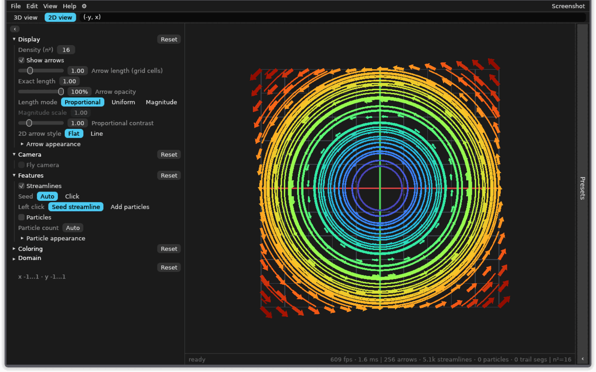

<p align="center">
  
</p>

# Vector Field Explorer

Type a vector field as a formula and explore it as arrows, streamlines, and
particles in 2D or 3D. Runs natively on Linux, macOS, and Windows, and in the
browser as a WebAssembly build.



Download the latest release from
[github.com/ttgg1/vector-field-explorer/releases/latest](https://github.com/ttgg1/vector-field-explorer/releases/latest),
or [try it online](https://ttgg1.github.io/vector-field-explorer/).

## What it is

Vector Field Explorer is a formula-driven viewer for fields
`f(x, y) -> (u, v)` and `f(x, y, z) -> (u, v, w)`. Type an expression, or load
one of the built-in field presets, and the viewport draws the field as an
instanced GPU scene:

- arrows coloured by magnitude, with separate 2D and 3D arrow families;
- streamlines traced with RK4, seeded from the grid or from clicks;
- animated particles with trails and speed or magnitude colouring;
- a Sources panel for mixed electric/current scenes, all eight source editors,
  E/B/Both display, scene-wide softening and a default-off accuracy opt-in,
  with source glyphs, projected off-slice markers, illustrative source presets
  and export warnings; see the [sources panel guide](docs/sources-panel.md);
- an Induction teaching demo for one editable current loop or finite solenoid,
  with separate E and B arrow families driven by the shared clock and
  reconstructed from a softened vector potential; see
  [Induction teaching demo](#induction-teaching-demo);
- an ODE workbench for bounded dynamical-system teaching: type `dx/dt`,
  `dy/dt`, `dz/dt` or integrate the current formula field, then play back up to
  eight fixed-step RK4 trajectories with an x/y phase portrait and per-variable
  time series on the shared clock; see [ODE workbench](#ode-workbench);
- a 2D orthographic view and a 3D orbit camera, plus a free-fly camera;
- adjustable domain, density, arrow lengths, opacity, colormaps, and
  plane-by-plane inspection, including 2D slices of three-component fields,
  with independent grid and coordinate guides;
- native PNG screenshots and persisted view, layout, and appearance settings.

Scalar **Curve** (`y = f(x)`) and **Surface** (`z = f(x, y)`) plots are
available from the Plot panel, with signed-height colors, depth-correct
references, and PNG capture. Curves and surfaces can read the shared
simulation time `t`, so Play/Pause animates them from the same clock as
particles and time-dependent vector fields; static plots stay idle. See the
[scalar plotting guide](docs/scalar-plotting.md) for syntax, examples,
draft/restart rules, sampling gaps and platform scope. Scalar SVG and scalar
CLI output are intentionally unsupported; SVG remains vector-field-only.

For scriptable, window-free 2D SVG or 2D/3D GPU PNG output, see the
[native CLI guide](docs/cli.md) (flags, strict JSON schema and examples).

The source-evaluator API (eight softened source kinds, family-local accuracy
and diagnostics) is summarized in the
[source accuracy notes](docs/sources-accuracy.md).

It is a teaching-grade explorer, not a general numerical solver: the native CAS
differentiates formulas and derives gradient, divergence, and curl, and the ODE
workbench precomputes bounded fixed-step RK4 teaching trajectories. There is no
adaptive/stiff ODE solver, PDE solver, or Maxwell-equation solver. The
architecture and module map are in [docs/CODEBASE.md](docs/CODEBASE.md);
domain vocabulary and settled decisions are in [GLOSSARY.md](GLOSSARY.md) and
[docs/adr/](docs/adr/).

## Install

### Linux

Download `vector-field-explorer-<version>-x86_64-unknown-linux-gnu.AppImage`
from the [latest release](https://github.com/ttgg1/vector-field-explorer/releases/latest),
make it executable, and run it:

```sh
chmod +x vector-field-explorer-*-x86_64-unknown-linux-gnu.AppImage
./vector-field-explorer-*-x86_64-unknown-linux-gnu.AppImage
```

The AppImage is one self-contained file. It uses the host GPU driver and
requires a Vulkan-capable driver (or a software implementation such as
`mesa-vulkan-drivers`); it does not bundle Mesa. If FUSE 2 is unavailable, run
it with `--appimage-extract-and-run` or install `libfuse2`. The AppImage's
`README.md`, `LICENSE`, and `THIRD_PARTY_LICENSES.md` are installed under
`usr/share/doc/vector-field-explorer/`.

### macOS

Download the archive for your Mac: `aarch64-apple-darwin` for Apple Silicon or
`x86_64-apple-darwin` for Intel. Unzip it and open
`vector-field-explorer.app`. The archive also contains `README.md`, `LICENSE`,
and `THIRD_PARTY_LICENSES.md`.

The macOS builds are unsigned and not notarized. On macOS 15 (Sequoia) and
later, the first launch is blocked; approve it in **System Settings → Privacy &
Security**, then choose **Open Anyway**. On older macOS, right-click (or
Control-click) the app and choose **Open**.

### Windows

Download `vector-field-explorer-<version>-x86_64-pc-windows-msvc.zip` from the
[latest release](https://github.com/ttgg1/vector-field-explorer/releases/latest),
extract it, and run `vector-field-explorer.exe`. The build is unsigned and no
installer is provided; the archive also contains `README.md`, `LICENSE`,
`THIRD_PARTY_LICENSES.md`, and `THIRD_PARTY_NOTICES.txt`.

Windows SmartScreen may show "Windows protected your PC": choose **More info**,
then **Run anyway**. Rendering goes through wgpu, which uses Vulkan when
available and falls back to DX12, so no separate MSVC runtime or WebView2 is
needed.

## Browser build and WebGPU

The browser build is the same Rust application compiled to
`wasm32-unknown-unknown`. It needs WebGPU; there is deliberately no WebGL2 or
CPU-rendering fallback. If the browser cannot provide a WebGPU adapter, the app
shows its own unsupported-browser panel with the failure reason instead of a
blank canvas. The panel's browser guidance is the same text as
`#webgpu-unsupported` in `index.html`.

A hosted browser build is live on the project Pages site:
[ttgg1.github.io/vector-field-explorer](https://ttgg1.github.io/vector-field-explorer/).
Build it locally with [Trunk](#browser-build-with-trunk).

### Browser support

WebGPU support is still uneven. This is the status as of November 2026:

| Browser | WebGPU status |
| --- | --- |
| Chrome / Edge | Available since version 113 on Windows, macOS, and ChromeOS. Linux support is rolling out: Intel Gen12+ from Chrome 144, NVIDIA on Wayland from Chrome 147 (driver 535.183.01+); other Linux configurations may need flags. |
| Firefox | Windows: 141+. macOS 26 Tahoe on Apple Silicon: 145+; all supported macOS versions: 147+. Linux: Nightly only, not Stable or Beta. |
| Safari | 26+ on macOS 26 Tahoe, iOS 26, and iPadOS 26. |

Sources: [MDN WebGPU API](https://developer.mozilla.org/en-US/docs/Web/API/WebGPU_API)
(limited availability), the [WebGPU implementation status](https://github.com/gpuweb/gpuweb/wiki/Implementation-Status),
[Mozilla's Firefox 141 announcement](https://mozillagfx.wordpress.com/2025/07/15/shipping-webgpu-on-windows-in-firefox-141/),
the [Firefox 145 release notes](https://www.firefox.com/en-US/firefox/145.0/releasenotes/),
the [Firefox 147 release notes](https://www.firefox.com/en-US/firefox/147.0/releasenotes/),
and [caniuse](https://caniuse.com/webgpu).

### Firefox on Linux

Linux Firefox Stable and Beta have WebGPU disabled today. Firefox Nightly has
it enabled by default, and Mozilla lists a Linux release as expected in 2026.
Use Nightly for a supported path.

To check or enable it:

1. Install Firefox Nightly from <https://www.firefox.com/en-US/channel/desktop/>.
2. Open `about:config` and accept the warning.
3. Check `dom.webgpu.enabled`. Nightly should already have it set to `true`; if
   the preference is present and `false`, set it to `true`.
4. If your GPU or driver is blocklisted, set
   `gfx.webgpu.ignore-blocklist` to `true`. Only do this when you know the
   driver works with Vulkan; a broken driver can crash the GPU process.
5. Restart Firefox.
6. Open the developer console and evaluate `navigator.gpu`. If it is
   `undefined`, WebGPU is still off. Then evaluate
   `await navigator.gpu.requestAdapter()`; `null` means no compatible adapter
   was found.

Firefox uses Vulkan for WebGPU on Linux. Install your distribution's Vulkan
driver package (for AMD and Intel Mesa, usually `mesa-vulkan-drivers`; NVIDIA
users need a recent proprietary driver with Vulkan support).
`vulkaninfo --summary` should list a device. The RADV (AMD) and ANV (Intel)
Mesa drivers are the usual choice; the software `lavapipe` driver also works
but is slow. Hardware acceleration must be enabled in Firefox's settings.

Troubleshooting:

- **`navigator.gpu` is `undefined`**: wrong Firefox channel, an older build, or
  the preference is off. Update Nightly or set `dom.webgpu.enabled`.
- **`requestAdapter()` returns `null`**: no Vulkan device, a blocklisted
  driver, a VM or remote session without GPU access, or hardware acceleration
  is off. Check `vulkaninfo --summary`, update Mesa, and try
  `gfx.webgpu.ignore-blocklist`.
- **The app shows its unsupported-browser panel**: read the reason line. The
  browser either lacks WebGPU or could not return an adapter; the app does not
  fall back to WebGL.
- **X11 vs Wayland**: try the other session type. Chromium's Linux WebGPU
  support differs between them (NVIDIA WebGPU on Wayland arrived in Chrome 147),
  and Firefox's GPU process can behave differently under each compositor.
- **Remote desktop, VM, or headless session**: WebGPU needs a usable local GPU
  and driver; software rendering may not expose one to the browser.

## Build from source

### Toolchain and system dependencies

Use a current stable Rust toolchain (edition 2024) installed through `rustup`.

Linux (Debian/Ubuntu package names; use the equivalents for your distribution):

```sh
sudo apt install build-essential pkg-config \
  libxkbcommon-dev libwayland-dev libx11-dev libxi-dev \
  libgl1-mesa-dev libvulkan-dev \
  mesa-vulkan-drivers libxkbcommon-x11-0
```

macOS: install the Xcode command-line tools (`xcode-select --install`).

### Native build

```sh
cargo build
cargo run --release
```

Run the test suite and the lint gate:

```sh
scripts/test.sh
cargo clippy --all-targets -- -D warnings
```

`scripts/test.sh` runs `cargo test --all-targets` and then removes stale test
binaries from `target/debug/deps`. Set `KEEP_TEST_ARTIFACTS=1` to keep them.

The runtime smoke test builds and launches the app for a few seconds, failing on
panics, wgpu validation errors, shader parse errors, and missing fonts:

```sh
scripts/smoke-run.sh 15
```

It needs a display. CI runs it headlessly with `xvfb-run`, software Vulkan
(`WGPU_BACKEND=vulkan`, `mesa-vulkan-drivers`), and `libxkbcommon-x11-0`.

### Browser build with Trunk

Install the WebAssembly target and Trunk 0.22.1 (the version pinned by the CI
wasm job in `.github/workflows/ci.yml` and matching the `wasm_bindgen` 0.2.130
pin in `Trunk.toml`), then serve or build:

```sh
rustup target add wasm32-unknown-unknown
cargo install trunk --version 0.22.1 --locked
trunk serve --release
```

Open <http://127.0.0.1:8080/>. A production bundle is written to `dist/` by:

```sh
trunk build --release
```

`scripts/test-web.sh` performs the same check and build in one step, then
verifies that `dist/` contains the HTML, wasm, JavaScript, manifest, Open Graph
image, and icon files. It selects the active rustup toolchain so a system
`cargo` without the wasm target is not used. No Node.js toolchain is required.

`index.html` is the Trunk entry point; `web/style.css`, `web/webgpu.js`, and
`web/pointer_lock.js` are the browser-only assets it copies. The WebGPU gate
lives in `src/main.rs` and runs before eframe starts; `scripts/check-web-bootstrap.sh`
checks that the gate and the static panel's guidance remain in place.

## Controls

### Formulas and field presets

Enter a comma-separated tuple in the formula bar:

- 2D: `(fx, fy)`, for example `(-y, x)`.
- 3D: `(fx, fy, fz)`, for example `(-y, x, 0.5)`.

The outer parentheses are optional. Components split at top-level commas, so
parentheses inside a component are respected. Variables are `x`, `y`, and `z`;
standard math functions such as `sin`, `cos`, `exp`, `sqrt`, `abs`, and `min`
are available, as are the constants `pi` and `e`. A vector formula may also use
the shared simulated time `t`, which animates it from the same clock as
particles and time-dependent scalar plots. Static formulas ignore the clock.

A formula that does not parse leaves the last valid field on screen and shows
the parse error in the status bar; it never blanks the viewport. A 3D formula
viewed in 2D uses its first two components.

The Presets panel groups the built-in field presets into Classic,
Electrostatics, Magnetostatics, and Electrodynamics. Clicking one loads its
formula and its 2D/3D dimension into the scene and returns to Formula mode,
leaving any saved source scene untouched; the formula remains editable.

### Induction teaching demo

Choose **Induction** in the Formula/Sources selector to open the dedicated
induction panel. It models one axisymmetric conductor: a circular current loop
or a finite continuous solenoid. Radius, solenoid length and turns, signed
current amplitude, frequency, and the E/B/Both display are editable; the
default shown current is `I(t) = amplitude * cos(2*pi*frequency*t)`. The shared
scene-wide softening `a` is editable under **Advanced** and affects Sources and
Induction alike.

This is a quasistatic, axisymmetric, softened teaching model. It has no
displacement current, radiation, retardation, free-charge electrostatics, or
physical singular limit, and its units are illustrative rather than
calibrated. Faraday's law fixes only the curl of `E`; an arbitrary measured `B`
therefore does not by itself determine `E`. The demo avoids pretending
otherwise: it reconstructs the azimuthal vector potential `A_phi` analytically
for the selected softened conductor and reports `E = -dA/dt`, with `B` from the
existing softened source evaluator. It is not an inverse-Faraday solve and not
a finite difference in time. A static current is exact: zero amplitude or zero
frequency gives `dI/dt = 0` and therefore zero induced `E`.

**Electric**, **Magnetic**, or **Both** selects the arrow families. `Both`
draws E in fixed amber and B in fixed cyan as separate arrows; the two families
are never summed, averaged, or forced onto one magnitude range. E and B are a
quarter cycle out of phase, so one can be empty at a chosen time.

Induction uses the one shared simulation clock: Play/Pause, step, reset-time,
speed, and loop are the existing transport, with no private timer. A static
induction scene has no clock consumer and leaves the transport hidden unless
another feature is using time. The mode is arrows-only: streamlines, particles,
and click seeding stay off, and their stored settings are preserved for other
modes. Switching modes preserves the current 2D/3D projection and the stored
density; induction sampling is capped at `20³` in 3D and `80²` on a 2D slice,
and invalid edits keep the last valid scene and arrows while showing the
actionable error.

The induced field and waveform are identical on native and web builds. The
native CAS differentiates the canonical waveform only to show a diagnostic
derivative string; both platforms evaluate the same analytic derivative for
the field, and the web build does not need a CAS port. The CAS string is not
exported or part of the physical result.

PNG and SVG exports always carry the induction model line and shared softening
plus any accuracy-not-met, unavailable, missing-sampling, or invalid-scene
warning. The default-off accuracy opt-in changes only which finite results are
drawn; it never suppresses a warning, raises a cap, or turns a non-finite value
into a vector. The induction scene (geometry, waveform, display, and opt-in)
persists with the view; older settings without those fields restore the default
valid loop scene in Formula mode.

Measured preparation times for the caps are in
[docs/perf/induction-performance.md](docs/perf/induction-performance.md). They
are cache-preparation measurements, not a frame-time target; the 33 ms
particle target is not claimed for induction. Browser/WebAssembly and manual
visual checks are owner-waived for this delivery, not claimed as passed.

### ODE workbench

Choose **ODE** in the Formula/Sources/Induction/ODE selector to open the
dedicated ODE panel. It is the fourth vector concept mode: the viewport stays on
the vector scene in the current 2D/3D projection, and the panel shows the scene
summary with **Open ODE**. The workbench is a precomputed teaching trajectory
viewer, not a general solver.

**Sources.** **Equations** accepts a 2D or 3D first-order system as
`dx/dt =`, `dy/dt =`, and (in 3D) `dz/dt =`, using the same expression parser,
functions, `pi`/`e` constants, and `x`, `y`, `z`, `t` variables as the formula
field. **Current field** integrates the durable current formula field instead:
it uses the field's dimension and the durable formula domain in world
coordinates, not the ODE viewport's fitted trajectory bounds, and it uses no
plane projection. A broken formula draft keeps the last valid ODE solution
visible, reports the parse error, and does not re-solve the stale field; a
successful parse queues the next solve.

**Integration and limits.** The solver is a fixed-step classical RK4 with
`h = 0.005`. Each seed starts at the integration time `t = 0`, and samples are
stored at `n * h` on that integration time, independently of playback. The
duration is 20 by default and editable from 0.1 to 25; up to eight finite
initial conditions are allowed. The cap is **4096 stored samples per
trajectory including `t = 0`**. At the default duration a trajectory stores
4001 samples and ends **Complete**; at 25 it exhausts the cap and ends
**StepLimit**, shown as a step-limit stop. A non-finite evolution stops only
that trajectory at its last finite sample with **NonFinite**; other seeds
continue, and no NaN/inf segment is drawn. An invalid scene or seed is
rejected, the last valid scene and solution stay in place, and the actionable
error appears in the panel and status bar.

**Playback.** ODE uses the one shared simulation clock for Play/Pause, Step,
reset-time, speed, and the time readout; **Step** advances exactly one RK4 step
and pauses. There is no private ODE timer and no ODE loop period: entering ODE
clears the shared loop period. Playback auto-pauses once at the solution
duration and mirrors the clamped time into the view, so clock and state cannot
drift. A valid scene edit or reset starts playback at `t = 0`; returning to Ode
without a new solution epoch keeps the current time. The existing particle RK4
implementation is unchanged; ODE adds no particle path.

**Charts.** The phase portrait is the x/y projection of the trajectory samples
(also x/y in a 3D scene; there is no 3D phase cube). The time series plots the
selected `x`, `y`, and/or `z` components against the integration time `t`.
Both read the same precomputed samples, never re-solve, and use up to eight
fixed seed colours with seed and current-time markers. The chart choice and
time-series variable selection persist with the view.

**Vector-only scope.** ODE is a vector-viewport concept. Arrows, particles,
streamlines, and click seeding are disabled or absent; the Features controls
are disabled with an ODE note, and Coloring is hidden because trajectories use
the fixed palette. Camera, Fit, and the coordinate-system toggle remain
available. The native CAS is Formula-only: ODE does not use CAS and the CAS
panel stays disabled outside Formula.

**Export and persistence.** PNG and SVG exports always carry the visible ODE
model warning (`ODE - fixed-step RK4 teaching model - h = 0.005`) and the
bounded-trajectory line, plus a timeline line when a solution exists, an
unavailable warning when it does not, and an invalid-scene warning when the
retained scene failed. Metadata records the model, source, dimension, step, and
duration. Non-finite samples are never exported, and no opt-in can suppress an
ODE warning. SVG remains 2D-only. The durable ODE scene (source, dimension,
equations, seeds, duration), chart choice, and visible variables persist with
the field mode. Restore validates lazily: malformed ODE fields fall back to the
default valid scene with an error, a legacy payload leaves Ode unselected, and
the first Ode frame solves the restored or fallback scene without a synchronous
solve during restore. Global reset restores the default ODE scene, clears its
solution and error, and returns to Formula.

Solve times are in
[docs/perf/ode-performance.md](docs/perf/ode-performance.md). They are
one-shot precomputed solve measurements, not frame-time targets; the 33 ms
particle target is not claimed for ODE. Browser/WebAssembly runtime and manual
visual checks are owner-waived for this delivery, not claimed as passed.

### Mouse and keyboard

| Input | 3D view | 2D view |
| --- | --- | --- |
| Left-drag | Orbit | Pan |
| Right-drag | Orbit | Pan |
| Shift + right-drag | Pan | Pan |
| Middle-drag | Pan | Pan |
| Wheel / pinch | Zoom | Zoom |
| Arrow keys | Orbit | Pan |
| Shift + arrows | Pan | Pan faster |
| `+` / `-` | Zoom in / out | Zoom in / out |
| `R` | Reset view | Reset view |
| `F` | Fit domain | Fit domain |
| Double-click | Reset view | Reset view |
| `S` | Seed a streamline at the pointer | Seed a streamline at the pointer |
| `P` | Add a particle burst at the pointer | Add a burst when the field has three components |
| `C` | Enter/leave the fly camera | Inert |
| Space | Play/pause when the transport is visible | Inert |

A single left click follows the **Features → Left click** setting: seed a
streamline or add a particle burst. The two are exclusive, and each does
nothing while its feature is off. Particles need a three-component field: in
2D they ride the selected plane slice, while ordinary two-component 2D has no
particles. Streamlines work in both views. The last six click seeds are kept.
Changing the plane selection clears those click seeds, because they belong to
the previous slice's local frame.

Fly mode is 3D-only: `W`/`A`/`S`/`D` move, `Q`/`E` move down/up, Shift boosts,
the mouse looks, the wheel changes flight speed, and `Esc` exits. While flying,
`S` is fly-backward rather than the streamline seed. Pausing the transport
freezes particle motion but leaves the view interactive.

### Panels, menus, and shortcuts

The Controls panel is on the left and the Presets panel is on the right. Click
a panel's chevron to collapse it to an edge rail; click the rail to expand it
again. `Ctrl+B` toggles Controls and `Ctrl+P` toggles Presets (`Cmd+B` and
`Cmd+P` on macOS). Drag the panel divider to resize a panel; widths persist. At
700 points of window width or less the app switches to a compact tab bar and
bottom sheet.

Under **Controls → Display**, **Show grid** and **Show coordinate system** are
independent checkboxes, both on by default. In 2D, the first shows the flat
domain grid and the second shows the coloured X/Y axes. In 3D, the first shows
the domain's face grids and wireframe box; the second shows only the coloured
X/Y/Z axes. They use the same settings in both modes; hiding either guide does
not hide arrows, streamlines, or click-seeded lines. The Display section's
**Reset** button restores both guides to visible.

When a three-component field is shown in **2D**, the viewport renders one
selected plane rather than the world X/Y box. The Display section shows **Slice
axis** and **Position**; the flat local grid and its two world-axis-coloured
axes replace the world guides. Arrows, streamlines and particles trace the
field projected onto that plane, so the out-of-plane (normal) component is
deliberately omitted—a purely normal field has zero slice flow. `F` fits the
flat slice locally, and entering a plane or changing its axis/position does the
same. The 3D **Plane by plane** toggle and **Off-plane opacity** remain 3D-only
controls; the 2D selector reuses the same axis/index and keeps the saved dim
toggle when you return to 3D.

Under **Features**, **Streamline count** follows the seed mode. `0` keeps the
density-driven Auto lattice; an explicit `1–4096` seeds exactly that many flow
lines from a density-independent lattice, so changing density does not change
the requested count.

The top menu bar contains:

- **File**: Export screenshot…, Quit.
- **Edit**: Copy formula, Reset all controls.
- **View**: Toggle Controls, Toggle Presets, Reset layout, Reset camera,
  Appearance….
- **Help**: Keyboard & mouse, Download desktop app, About Vector Field Explorer.

Appearance (the gear in the top bar or **View → Appearance…**) edits the theme,
accent colour, rounding, spacing, and font size. The same popover is available
in compact mode from the hamburger menu.

Global shortcuts:

- `Ctrl+Shift+S`: export a screenshot. Native uses a save dialog; the browser
  downloads a PNG.
- `Ctrl+Shift+C`: copy the current formula.
- `Ctrl+Q`: quit.
- `F1` or `?`: toggle the help overlay.
- `Esc`: close dialogs and dismiss the help overlay.

On macOS, use `Cmd` instead of `Ctrl` for every chord above; the app follows
egui's command modifier.

The **Help → Keyboard & mouse** window shows the full binding table; the
in-viewport overlay shows the active view's bindings plus the global ones.
**Help → About** shows the build version and the project links.

## Persistence

The app writes one settings envelope under eframe's app key. The following
survive a restart:

- the view state: formula or loaded preset, 2D/3D mode, domain, density, arrow
  settings, colouring, streamline and particle settings, the saved source scene
  (entries, display, softening and accuracy opt-in), the saved induction scene
  (case, center, axis, radius/length/turns, amplitude/frequency, display and
  accuracy opt-in), and the saved ODE scene (source, dimension, equations,
  seeds, duration, chart and visible variables) with its field mode, plus the
  Show grid / Show coordinate system preferences (remembered across both
  modes);
- the layout: panel visibility, panel widths, and help-overlay visibility;
- the appearance: theme, accent, rounding, spacing, and font size.

Camera state does **not** survive a restart by design: the live orbit/fly pose
resets on launch. Use a **camera preset** to save and restore a viewpoint.
Camera presets are named 2D camera records (target position and zoom); a **field
preset** is a formula definition. The distinction is defined in
[GLOSSARY.md](GLOSSARY.md).

Corrupt or partial settings fall back to defaults or clamp to valid ranges;
older saved views without the guide preferences show both guides by default.
Older payloads without induction fields restore the default valid current-loop
scene; malformed induction fields also fall back to that scene and report the
validation error instead of failing startup. Older payloads without ODE fields
leave Ode unselected and set no ODE error; malformed ODE fields keep an
explicitly stored Ode mode, restore the default valid ODE scene, report the
validation error, and solve lazily on the first Ode frame.
Camera presets stay fail-fast: a corrupt or foreign-format preset file is
logged and left untouched rather than silently overwritten (a missing file
starts with an empty list), and save or delete failures surface a non-blocking
note in the Presets panel. On the web, eframe's browser storage is used and
camera presets use `localStorage`.

## Limitations

- **Fields may be time-dependent.** Vector formulas and scalar plots may
  reference the shared time `t`; the Electrodynamics presets themselves are
  static spatial snapshots, not a wave simulation.
- **Induction is a teaching approximation.** Quasistatic, axisymmetric and
  softened, with no displacement current, radiation, retardation, or physical
  singular limit. It is not a general Maxwell or inverse-Faraday solver, and
  the cap timings are preparation measurements rather than frame-time claims.
- **No data import or export.** The input is a formula, a built-in preset, or an
  editable source or induction scene. Screenshots are PNG, or 2D SVG; there is
  no CSV, NumPy, or project-file import.
- **No general solver.** The native CAS differentiates formulas and derives
  gradient, divergence, and curl. The ODE workbench is a bounded fixed-step RK4
  trajectory viewer: it has no adaptive/stiff solver, symbolic integration,
  parameter sweep, or 3D phase cube, and solve timings are not frame-time
  claims. It does not solve PDEs or Maxwell's equations.
- **NaN and infinite samples are skipped.** A pole inside the domain leaves a
  hole in the arrows rather than crashing or blanking the scene; a parse error
  keeps the last valid field. Built-in singular-looking presets are softened.
- **Particles need a three-component field.** In 3D they fill the volume; in 2D
  they ride the selected plane slice. Ordinary two-component 2D has no depth or
  slice flow for a dot, so the toggle stays inert there. The 2D slice selector
  and the 3D plane inspector share one axis/index and step through x, y, or z.
- **No WebGL2 fallback.** The browser build requires WebGPU, and an unsupported
  browser gets the app's explanation panel.
- **No signing, notarization, auto-update, or telemetry.** macOS builds are
  unsigned; the Linux AppImage has no update information.

## License

Vector Field Explorer is licensed under **GPL-3.0-only**. See [LICENSE](LICENSE)
for the full text and [THIRD_PARTY_LICENSES.md](THIRD_PARTY_LICENSES.md) for the
third-party notices. The software is provided without warranty; see the licence
for the exact terms.
